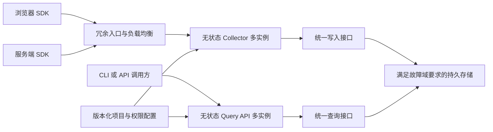

# OneAster Telemetry 系统与技术架构

状态：首期实现架构。协议、SDK、服务、PostgreSQL 驱动和 CLI 已实现；生产拓扑与容量要求仍须按验收记录验证。

配套文档包括 [SDK 与 API](SDK-AND-API.md)、[服务端与存储](BACKEND.md)、[生产运行](OPERATIONS.md) 和 [实施与验收](DELIVERY.md)，分别细化契约、持久化、运行和验证职责。

## 1. 已确认目标与设计前提

已确认：独立项目、自主实现、免费开源基础设施、自行托管、无产品管理界面、集中保存、API/CLI 查询、代码埋点与异常捕获、不使用 Kafka。

生产可用性目标为 99.99%。单节点或单可用区故障下，服务已确认接收的数据不得丢失。该持久性承诺覆盖约定保留期内的数据；正常到期删除不属于数据丢失。

用户要求比较 PostgreSQL、SQLite、ClickHouse，以及统一存储接口。本方案以 TypeScript/Node.js 服务、统一存储端口、PostgreSQL 作为首期实现基线。容量与保留采用运行方案的显式验证基线；真实部署资源和故障域仍需确认，不能把基线当作实测容量。

浏览器关闭、断网或进程退出前尚未获得服务端确认的事件，属于未确认数据。平台的服务可用性与浏览器端的实际送达率分别度量。平台不作为业务账本，充值、扣费和真实调用结果仍由 Core 持有权威状态。

## 2. 数据库比较与建议

| 维度 | PostgreSQL | SQLite | ClickHouse |
| --- | --- | --- | --- |
| 对本项目的适配 | 结构化事件、错误检索、幂等收据、可选后台任务 | 本地开发、离线使用、单机部署 | 大量追加事件、时间范围扫描、聚合分析 |
| 幂等与一致性 | 可用事务和唯一约束建立明确的写入确认规则 | 单机内可用事务与唯一约束 | 重试去重有窗口和写入设置约束；不能把后台合并等同于立即唯一 |
| 高可用路径 | 同步复制、自动切换、仲裁与旧主隔离 | 原生单文件不是跨可用区复制方案，需要额外复制系统 | 数据副本、写入 quorum 与 Keeper 仲裁 |
| 主要工程代价 | 高可用运维、索引与分区维护、大量扫描的成本 | 无法直接承担当前生产高可用承诺 | 批量写入、重复事件处理、读取可见性、Keeper 与副本运维 |
| 当前建议 | 首期生产驱动候选，优先推荐 | 明确标为单机能力，作为后续开发驱动候选 | 当实际数据和查询负载支持其收益时，作为生产驱动候选 |

首期实现 PostgreSQL 驱动，提供 development 和 ha 两种配置。大量事件分析可能更适合 ClickHouse，但目前没有事件量、事件大小和查询形态的数据，不能直接断言某种存储可以承载目标容量。

统一业务存储接口与 PostgreSQL 驱动已实现。首期无需同时维护三套生产适配器。数据库切换仍需要存量迁移、结果核对、切换窗口和回退设计，接口统一不意味着数据能够自动迁移。

SQLite 的 WAL 允许读写并发，但同一时刻仍只有一个写入者，且不适合把数据库文件放在网络文件系统上作为跨主机协调方式。[SQLite WAL](https://www.sqlite.org/wal.html)

ClickHouse 重试去重依赖去重窗口与插入语义；后台合并不能替代明确的事件唯一性契约。[插入重试去重](https://clickhouse.com/docs/concepts/features/operations/insert/deduplicating-inserts-on-retries)

## 3. 推荐逻辑架构



Collector 与 Query API 复用协议和存储适配代码，生产时分开部署、独立限流和分配资源。查询过载不应耗尽接收服务的连接和执行预算。

首期直接写入生产数据库，不引入外部消息队列。Collector 对每个协议批次直接同步写库，不维护跨请求事件缓冲；SDK 队列中的事件不得被确认为持久化成功。数据库不可用时返回可重试失败，不能用本机日志或内存队列替代成功确认。

首期项目、环境、域名白名单和服务帐号权限使用版本化配置，凭证通过部署系统的秘密配置分发。配置在实例启动和更新时完整校验，原子替换，并通过配置版本监控多实例一致性。这样无需另建项目管理数据库。人员 SSO 与交互式管理后台不在当前范围内。

## 4. 模块职责与实现技术栈

| 模块 | 职责 | 状态与依赖边界 |
| --- | --- | --- |
| 协议 | 事件信封、错误结构、字段约束、版本兼容规则 | 不依赖浏览器、框架或数据库 |
| 浏览器 SDK | 手工埋点、浏览器异常、有限队列、批量上报、身份上下文清理 | 不持有私密服务凭证，不包含数据库依赖 |
| 服务端 SDK | 显式事件与错误、请求上下文、有限重试、关闭时排空 | 用户上下文按请求传入，不使用跨请求可变用户单例 |
| 框架适配 | React 错误边界、Next.js 初始化与服务端错误钩子 | 客户端和服务端独立导出，框架依赖不进入通用 SDK |
| Collector | 鉴权、来源标记、校验、脱敏、限流、持久化确认 | 不保存唯一业务状态，不承诺内存队列可靠性 |
| Query API | 项目隔离、有限查询、错误详情、游标分页、结果导出 | 固定查询能力，不开放任意 SQL |
| 存储适配 | 实现写入与查询语义、迁移、保留期清理 | 数据库细节集中于各自驱动 |
| CLI | 调用查询 API、输出 JSON/文本、按请求 ID 排查、离线源码映射 | 不直接连接生产数据库，令牌不通过命令行参数传递 |

实现采用 TypeScript、ESM、Node.js 26 服务与 CLI、Bun 工作区和脚本、Fastify 5、Zod 4、`pg` 8 参数化 SQL 和 PostgreSQL 18。SDK 与接收端共用 protocol 的 `zod/mini` schema；公共类型定义位于 protocol/types.ts，运行时输入以 schema 校验。

依赖补丁以仓库 package.json、bun.lock 为准，生产 Node 镜像与摘要见 Dockerfile。构建生成的 dist/build.json 记录实际 Node 版本与浏览器包大小；本机验证不替代目标镜像和生产容量验收。

Go 保留为未来语言重评选项，首期不同时维护两套服务端实现。Bun 业务侧 SDK 需要兼容性验证，Bun 不作为平台首期生产服务运行时。工程检查采用 TypeScript、类型感知 oxlint、bun fmt、Vitest、Playwright 和真实 Node/数据库集成验证；脚本以 package.json 为准。

主要实现目录如下：

```text
packages/protocol/
packages/sdk/
packages/application/
packages/storage-contract/
packages/storage-postgres/
packages/cli/
apps/collector/
apps/query-api/
tests/system/
docs/
```

协议不依赖 SDK、应用或存储；应用只依赖协议与端口；驱动实现端口；入口负责装配。SDK 的 browser、server、react、next/client 与 next/server 独立导出。SQLite、ClickHouse 适配目录在进入实施范围后再创建。

## 5. 统一存储接口的语义

统一业务能力，不封装通用 SQL、表结构或 ORM 查询构造器。核心入口为 `appendBatch`、`findEvents`、`findErrors` 和 `getEvent`；保留期清理与数据库迁移是适配器运维职责。

所有入口必须接收超时和取消信号。游标为不透明值，绑定查询条件与驱动版本，不保证跨数据库迁移后仍然有效。

| 规则 | 所有生产驱动必须满足的契约 |
| --- | --- |
| 确认成功 | 整个成功响应所列事件已达到生产配置要求的跨故障域持久性，不只是进入本机缓冲 |
| 事件身份 | 项目、环境、服务、可信来源类别、事件 ID 共同确定一次逻辑事件；重试沿用相同身份和载荷 |
| 不确定结果 | 超时或连接中断可能发生在存储完成之后；调用方按相同事件身份重试，不能假设一定未写入 |
| 失败中的部分写入 | 统一接口不要求所有数据库提供原子批次；批次失败时允许部分落库，重试必须保持逻辑幂等 |
| 查询 | 固定筛选条件、有限时间范围和分页；相同逻辑事件不因重试重复出现在逻辑结果或计数中 |
| 可见性 | 明确声明读取一致性与可见延迟；高可用持久化成功不自动等于所有只读副本立即可见 |
| 来源与隔离 | 项目和可信来源由接收服务确定；驱动不能信任载荷中的项目归属和来源自述 |
| 能力检查 | 单机持久化、跨故障域持久化、读取一致性等能力在启动时核对；不满足生产要求时启动失败 |

PostgreSQL 可使用事务和唯一约束提供比基础接口更强的批次原子性。ClickHouse 适配器需要单独解决查询侧逻辑去重与有限插入去重窗口；未通过同一套契约测试前，不视为等价驱动。SQLite 驱动必须显式拒绝当前生产高可用配置。

未来支持其他主流数据库时，应提供真实适配器和同一套行为测试、高可用演练证据，不能仅通过连通性测试就标为支持。

## 6. 首期 PostgreSQL 高可用候选

拓扑建议为三个独立可用区，每个可用区至少一个数据库节点。采用一个主库和两个候选备库，由 Patroni 管理同步复制、自动切换；三节点 etcd 仲裁分别分布在三个可用区。数据库连接入口同样必须冗余，并只把写入路由到有效主库。

生产配置要求同步提交、严格同步模式，以及至少一个位于不同可用区的同步备库确认。同步副本选择交给 Patroni 管理，旧主隔离机制和网络分区行为必须验证。禁止在缺少安全同步副本时自动降级为异步写入并继续返回成功。

在上述拓扑与故障模型成立时，一次成功写入应已存在于至少两个可用区。自动切换只允许提升包含已确认提交的合格副本；不通过强制提升落后副本来维持表面可用。

PostgreSQL 流复制默认是异步的，只有明确配置同步复制才有相应的提交等待行为；同步复制也会引入网络延迟和可用性取舍。[PostgreSQL 同步复制](https://www.postgresql.org/docs/current/warm-standby.html#SYNCHRONOUS-REPLICATION)

Patroni 的同步模式、严格模式和安全提升规则需要结合选定版本验证，不能把“主从复制”直接等同于自动切换零丢失。[Patroni 复制模式](https://patroni.readthedocs.io/en/latest/replication_modes.html)

逻辑存储包含不可变事件和幂等收据。收据记录事件身份、不可变 kind、确定性载荷摘要和首次接收时间；相同身份及载荷按原逻辑事件确认，载荷冲突明确拒绝。收据和事件在同一事务写入并约束类别一致；原事件删除后，收据仍须遵守查询的服务与类别授权。

重复确认也必须经过同步写入屏障：仅查询已存在记录就返回成功，可能确认一个在主库本地可见、尚未完成同步确认的提交。驱动对相同载荷的重复收据更新确认 nonce，再等待同步 COMMIT；不能把重复路径优化成只读返回。端口、状态和完整事务见 [服务端设计](BACKEND.md)。

同步 COMMIT 使用驱动独立截止、WARNING 可达性核验和有界后端清理；statement_timeout 不提供该等待上界。取消或截止后确认未知不可逆，晚到 COMMIT 不得改为成功；清理失联时保留连接预算并停止相应准入。

原始事件按时间分区时，跨分区幂等由独立收据表保证，不能假定时间分区表存在不含分区键的全局唯一约束。收据保留窗口至少覆盖数据保留期与支持的重试窗口。清理分批进行，并与写入和查询使用独立资源预算。[PostgreSQL 分区约束](https://www.postgresql.org/docs/current/ddl-partitioning.html#DDL-PARTITIONING-DECLARATIVE-LIMITATIONS)

首期查询从主库读取，以减少错误详情的可见性差异；使用独立连接池、超时和资源上限。每次 reader 调用明确采用 REPEATABLE READ、固定到期判定时刻 as_of，并与分区移除遵守同一父表锁协议，避免收据与事件读取跨快照。读副本扩展必须先定义可接受的陈旧度，再调整查询契约。

## 7. ClickHouse 与 SQLite 的接入边界

ClickHouse 生产候选建议每个分片三个副本，分别位于三个可用区，另有三节点 Keeper 仲裁。写入需要明确的 quorum，例如三副本下要求至少两个副本成功。不能沿用默认异步复制语义就承诺单可用区故障下已确认数据不丢。[ClickHouse quorum 写入](https://clickhouse.com/docs/reference/settings/session-settings/insert-quorum)

如果采用异步插入，成功响应必须等待刷入存储；同时验证 quorum、刷盘设置、失败重试和目标版本的实际组合行为。读取可见性与去重策略需要单独验收。[异步插入确认](https://clickhouse.com/docs/concepts/features/operations/insert/asyncinserts)

ClickHouse 专用分析查询可以作为额外能力暴露，不强求其他数据库模仿其全部聚合能力。严格的同 ID 异载荷并发冲突与长期收据需要额外机制；仅凭插入去重窗口，不能声明它满足当前强写入契约。未来可评估派生分析存储或配有可靠收据层的写入方案，首期不实施双存储链路。

SQLite 仅作为本地或单机驱动候选。若未来讨论额外复制系统，必须把该系统的仲裁、故障域、复制确认和恢复行为作为新的完整方案评估，不把它当作同一个单机驱动的配置开关。

SQLite 未进入首期实现；接入前必须核对实际引擎补丁、复制与恢复能力。

## 8. SDK、事件与接收协议

业务调用入口为 `track(name, properties)` 和 `captureError(error, context)`，另外提供有截止时间的 `flush` 与负责清理监听、定时器和请求的 `close`。返回事件 ID 仅表示 SDK 已建立该事件，不表示服务端已持久化。

事件信封包含协议版本、事件 ID、发生时间、项目、环境、服务、发布版本、事件类别和有限业务属性。请求 ID、追踪 ID 和不透明用户 ID 为可选上下文；接收时间、可信来源和认证主体由服务端生成或确认。

浏览器全局捕获覆盖运行时异常和未处理 Promise 拒绝；React 渲染错误通过错误边界适配。Next.js 服务端使用 `instrumentation.ts` 的 `onRequestError`，并保留现有启动配置校验。业务代码已经捕获并转换成失败结果的异常，需要在对应边界主动记录。

客户端 SDK 仅建立轻量、可清理的早期监听。页面访问埋点由业务在已完成的导航边界显式调用 track 触发。服务端不安装改变进程退出语义的全局异常处理器；致命退出的排空仅为尽力执行。

接收端点分别为 `POST /v1/ingest/browser` 和 `POST /v1/ingest/server`。浏览器端使用公开项目标识、域名约束和限流，其来源始终为不可信客户端。服务端端点使用项目范围私密写入凭证。浏览器载荷不能通过修改字段获得可信服务端来源。

成功响应仅在存储适配器完成所需持久化确认后返回。建议使用 `200` 并列出已确认事件 ID。重试耗尽或写入状态不确定时返回可重试错误；协议错误、权限失败、过大载荷和事件身份冲突分别明确响应。

SDK 队列、事件大小、批量大小和重试次数必须有上限，按项目隔离。普通事件与异常的容量预算分开，满载与丢弃数量可观测。上报失败不递归生成新的上报异常。

正常运行时通过可读取确认响应的请求上报。页面隐藏时的 Beacon 仅作为补发机制，不能把其入队成功当作持久化成功。[Beacon 规范](https://w3c.github.io/beacon/)

框架接入依据是当前 OneAster Client 安装版本的 Next.js 本地文档，以及现有启动钩子、请求错误转换实现。该业务仓库本次只读，不接入 SDK。

## 9. 查询、安全与无头运维

查询 API 提供按项目、环境、时间、事件名称、错误类别、发布版本、请求 ID 的有限检索，以及错误详情和分页导出。CLI 通过同一个 API 调用，输出 JSON 或文本。所有查询必须限定项目和时间范围，限制扫描量、并发和超时。

公开写入标识不是安全凭证，Origin/CORS 也不是服务身份认证。写入、读取和配置管理使用不同权限；查询端通过服务帐号范围校验实现项目隔离。生产数据查询和配置变更产生审计记录。

请求头、Cookie、API Key、提示词、模型回复、上传内容与签名 URL 默认不采集。URL 去除查询和片段，错误仅保留允许的安全字段；属性使用白名单。用户上下文在退出登录和切换帐号时清理。首期不启用全量自动点击采集和会话回放。

SDK 不读取或解析调用方的原始 message、stack 或 cause，仅保留安全错误类型、注册 code/message 与关联上下文，SDK 错误的 frames 数组为空。Collector 仍支持结构化位置帧；源码映射按服务、发布版本和构建标识匹配，由 CLI 使用本地构建产物离线定位，并保留未映射的结构化帧。接收服务不根据事件中的任意 URL 下载源码或映射文件。

所有服务通过 JSON 日志、指标和健康端点观测。外部探针验证真实写入、读取和延迟，监控数据库切换、复制延迟、仲裁、队列丢弃、过载、磁盘和证书。监控与通知链路也需要跨故障域部署，不依赖业务采集链路报告自身故障。

## 10. 99.99% 与验收方式

99.99% 先作为采集和查询分别计算的生产目标。采用 30 天窗口时，等价时间错误预算约为 4 分 19 秒，但请求成功率和连续故障时长仍需分别观察。

采集成功率分母是到达公共入口、格式与凭证有效且处于已约定项目配额内的请求。服务自身过载产生的失败计入错误预算，不能通过返回 429 将其排除。健康检查成功不替代业务链路成功。

延迟、故障恢复与容量采用 [生产运行方案](OPERATIONS.md) 的建议验收基线，需真实负载校准。单节点或单可用区故障下，已确认事件 ID 在恢复后必须全部可查询；网络分区下缺少安全写入条件时明确失败，不能冒险确认。

| 验证场景 | 必须观察的结果 |
| --- | --- |
| 存储已完成，响应在网络中丢失 | 同事件重试后逻辑结果只有一次，不丢失 |
| Collector 在内存批量缓冲时退出 | 未确认为成功；SDK 可按原事件身份重试 |
| 数据库主节点退出或单可用区隔离 | 安全切换，已确认事件无缺失，记录实际恢复耗时 |
| 旧主与仲裁失联 | 隔离旧主，不能出现两个可确认写入的主节点 |
| 同步副本不足 | 明确失败，无自动异步降级后继续确认 |
| 查询过载或恶意大查询 | 受到扫描、资源和并发限制，采集资源受到保护 |
| 重复 ID、跨项目请求、伪造服务端来源 | 幂等、冲突与权限行为符合契约 |
| SDK 重复初始化、关闭、请求取消 | 监听和任务可清理，不重复采集，不跨用户串上下文 |
| 滚动发布与协议升级 | 在兼容窗口内持续工作，配置和模式迁移可回退 |
| 备份还原与逻辑误删恢复 | 实际还原并核对数据；备份 RPO/RTO 单独记录 |

故障演练、浏览器端到端测试和负载测试必须在选定运行时与真实部署拓扑上执行。单机启动多个容器只能验证部分协议行为，不能作为跨可用区高可用证据。

## 11. 下一步讨论与实施切片

待确认：首个生产驱动、服务端语言、每日事件量与峰值、平均及最大事件大小、查询形态与并发、保留期、可用区和主机资源、入口网络、备份目标。

容量评估使用事件速率、事件大小、压缩率、索引放大、复制份数和保留时间计算，再通过混合读写与故障负载验证。目前不承诺吞吐、机器规格或存储成本。

建议实施顺序：先确定协议和存储语义；实现首个驱动及契约测试；闭合服务端写入与 API/CLI 查询；接入浏览器和框架异常；完成源码映射定位；最后通过真实故障域演练、压测和发布回退验收。每一阶段都保留明确的可观察结果。

详细任务依赖、真实垂直切片和验收场景见 [实施与验收计划](DELIVERY.md)。本轮只维护设计包，检查、审查与未验证事项在该文档中记录，不把静态推演记作运行验证。
