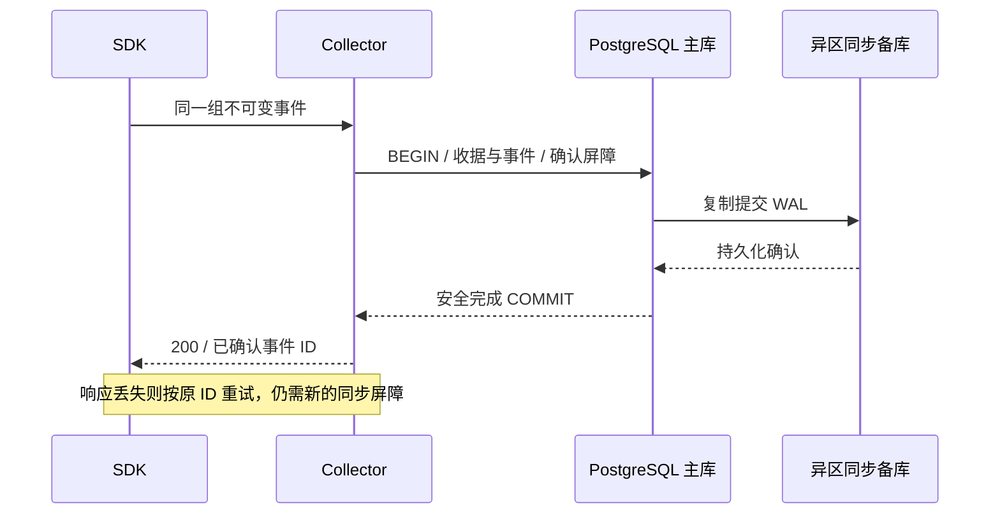

# 服务端、数据模型与统一存储接口

状态：首期服务端与存储契约。DDL、迁移和维护实现在 packages/storage-postgres，实际验证边界见 implementation/ACCEPTANCE.md。HTTP 字段和错误码见 [SDK 与 API](SDK-AND-API.md)，故障域与运行配置见 [生产运行](OPERATIONS.md)。

## 1. 领域、权威状态与不变量

| 对象 | 权威写入者 | 生命周期与规则 |
| --- | --- | --- |
| ProjectPolicy | 受控配置部署 | 版本化、签名或受完整性保护、原子生效、有效期与权限明确 |
| Credential | 秘密配置部署 | 创建、重叠轮换、撤销、过期；每次调用重新授权 |
| Event | Collector | 不可变安全记录，包含信封快照和项目策略版本；按保留期到期 |
| IngestReceipt | 存储驱动 | 事件身份、不可变 kind、载荷摘要、首次时间与保留期；重复确认只更新内部确认信息 |
| QueryAudit | 查询驱动 | 记录谁在什么范围做了何种查询、结果数量与请求标识，不保存返回正文 |
| ErrorFingerprint | Collector 派生 | 同项目、环境、服务、发布范围内的分组键，可从规范事件重建 |

核心不变量：

1. 事件身份为 `(project_id, environment, service, source, event_id)`；release、build_id 是不可变载荷的一部分。
2. 同身份同载荷只对应一个逻辑事件；同身份异载荷明确冲突，不能静默覆盖。
3. 所有成功确认，包括重复确认，都满足当前生产跨故障域持久性要求。
4. 重试不改变首次接收时间、保留期限或原安全记录；不得通过重复上报无限延长保留。
5. 事件与收据在首期 PostgreSQL 驱动同一事务提交；成功确认不能只留下孤立收据。
6. 项目、环境、服务授权集合、查询允许类别和来源隔离贯穿鉴权、SQL、收据、游标、审计、导出与指标。
7. 未知结果可安全按相同身份重试；不把超时解释为一定未提交。
8. 保留到期、授权失败、数据库不可用与成功空结果是不同结果，不能混用。

## 2. 状态与失败窗口

SDK 状态为 queued → in_flight → acknowledged，或进入 retry_wait、dropped。网络中断时可处于 unknown，保持相同身份重新发送。服务端不为未确认请求维护依赖本机内存的权威状态。

数据库可观察到本地已经提交、同步确认尚未返回的记录；不能仅因 SELECT 能读到记录就宣布它已经符合跨可用区确认条件。成功响应与数据库可见性是两个不同事实。

| 交错 | 处理 |
| --- | --- |
| 两个实例同时接收同身份同载荷 | 唯一键串行化收据竞争；一个创建，另一个在同步确认屏障后复用 |
| 两个实例接收同身份不同载荷 | 唯一键竞争结束后比较规范摘要，不一致的一方冲突 |
| 提交前进程退出 | 未确认；事务回滚或结果未知；按原身份重试 |
| 本地提交后、同步确认前断开 | 结果未知；不得从只读重复路径直接确认 |
| 同步提交后、HTTP 响应丢失 | 重试通过相同身份和新的同步屏障确认原事件 |
| 原事件到期后重试 | 存在过期收据时返回 410；不得复活原事件 |

幂等保证覆盖记录保留期及额外收据窗口，不是无限期身份注册。超过该窗口重用 ID 属于协议误用，不承诺识别；SDK 总重试预算远小于窗口。

## 3. 统一存储端口

以下为接口设计片段；完整类型从协议和本节领域规则生成，不是已经可导入的代码。

```ts
type OperationOptions = {
  signal: AbortSignal;
  deadlineAtMs: number;
};

type StoreCapabilities = {
  driver: string;
  contractVersion: 2;
  durability: 'single_node' | 'fault_domain_sync';
  idempotency: 'strict_receipt' | 'windowed';
  readConsistency: 'primary_committed' | 'eventual';
  auditedReadBarrier: boolean;
};

interface EventWriter {
  appendBatch(batch: CanonicalBatch, options: OperationOptions): Promise<WriteReceipt>;
}

interface EventReader {
  findEvents(query: EventQuery, access: QueryAccess, options: OperationOptions): Promise<EventPage>;
  findErrors(query: ErrorQuery, access: QueryAccess, options: OperationOptions): Promise<EventPage>;
  getEvent(key: EventKey, access: QueryAccess, options: OperationOptions): Promise<EventLookup>;
}

interface TelemetryStore {
  capabilities: StoreCapabilities;
  writer: EventWriter;
  reader: EventReader;
  readiness(options: OperationOptions): Promise<StoreReadiness>;
  close(options: OperationOptions): Promise<void>;
}
```

CanonicalBatch 包含已认证 scope、不可变规范载荷摘要、安全投影和策略版本；不能接受浏览器自行声明的可信 scope。WriteReceipt 为逐事件确认信息。EventLookup 明确区分 found、expired 与 absent；权限和依赖错误使用分类异常，不能用 null 代替。

QueryAccess 包含当前已授权项目、环境、非空 allowedServices 与 allowedKinds 集合、权限类别、服务帐号、请求 ID 和审计描述。allowedKinds 由当前权限与端点共同确定：events 端点要求 read:events，允许 event/error；errors 端点要求 read:errors，固定只允许 error，调用方不能自行扩大。列表筛选与授权集合求交，省略 service 不扩大授权；详情和过期收据查找也应用相同服务与类别限制。

reader 的一次调用必须在一个数据库连接的 REPEATABLE READ 事务中完成读取、审计和同步确认屏障后返回，并固定本次到期判定时刻 as_of，详见第 7 节；不能在旧主读完，再在新主补审计并返回旧结果。

首期 HA 配置要求 `fault_domain_sync`、`strict_receipt`、`primary_committed` 和有效查询审计屏障。静态能力声明还必须与真实拓扑、权限和运行设置核对。SQLite 声明 single_node 时拒绝 HA 配置；ClickHouse 原生窗口去重不能冒充 strict_receipt。

迁移和保留管理使用驱动内部管理能力及独立管理角色，不暴露为公网通用 SQL。不同数据库可拥有不同物理表、索引与查询计划；端口统一业务行为，不要求统一 SQL 或物理事务实现。

## 4. 规范化、摘要与错误分组

接收顺序为：当前认证 → 限制体积并解析 → v1 结构校验 → 形成规范载荷摘要 → 按项目策略生成安全投影 → 存储事务。认证与策略来自有效配置，不信任事件自述。

摘要覆盖规范客户端事件、environment、service、release、build_id，不覆盖公开项目 key、私密凭证、HTTP request_id、接收时间或服务端策略版本。公开 key 或凭证轮换不使原事件冲突。

规范化固定对象键顺序、UTF-8 编码、UTC 毫秒时间、有限数字表示，拒绝非安全整数，负零规范为零，不做 Unicode 内容归一化。规范化算法随 schema_version 冻结，提供包含非 ASCII、空值、小数与边界整数的独立样本。摘要为 SHA-256，仅内部收据保存，不通过查询 API 输出。

摘要基于固定 v1 客户端规范载荷，安全投影是另外的派生结果。因此项目安全投影规则变更不会让同一原事件因接收时间或策略版本变化产生不同摘要；重复事件保留原投影，不重新覆盖历史。当前权限撤销始终优先于幂等重放。

fingerprint v1 使用项目、环境、服务、来源、release、错误类型、已注册 code、前三个规范位置帧生成，避免浏览器事件混入可信服务端分组。默认 message 不参与分组。分组算法版本单独保存；跨发布智能归并和错误解决状态不在 v1 范围。

## 5. PostgreSQL 逻辑数据模型

以下为目标模型，实际 SQL 迁移要在 PostgreSQL 18 环境验证后生成。

| 表 | 关键字段、键与约束 | 依据 |
| --- | --- | --- |
| ingest_receipts | 主键 project_id / environment / service / source / event_id；kind、payload_digest、first_received_at、retain_until、tombstone_until、first_operation_id、confirmation_nonce、policy_version；另设身份加 kind 的唯一约束 | 唯一事件身份、类别授权、冲突检查、固定保留期与重复确认屏障 |
| telemetry_events | project_id / environment / service / source / received_at / event_id 复合主键；occurred_at、release、build_id、kind、name、properties、context、error、fingerprint、policy_version、retain_until | 不可变事件与有界检索；按 received_at UTC 日分区 |
| query_audit | audit_id、project_id、environment、actor_key_id、request_id、query_kind、query_digest、as_of、row_count、created_at、retain_until | 查询访问记录、到期判定时刻和同一事务中的同步写入屏障 |

source、kind 设检查约束；事件与收据的 kind 均非空且不可变。事件通过包含完整身份与 kind 的复合外键引用收据，保证类别一致；收据身份主键仍不包含 kind，同身份改换类别仍是载荷冲突。收据保留 kind 到 tombstone_until，事件物理删除后仍可执行类别授权。

关键范围、身份、接收时间和保留时间非空。收据和事件同事务写入；存储驱动禁止通过其他路径单独创建有效收据。仅当同一读取快照内，已授权收据在 as_of 尚未到期、原事件却缺失时，才返回完整性错误；不得把正常到期或越类别记录误报为损坏。

分区表主键包含 received_at 分区键。跨分区唯一性由独立收据主键保证，不能假定事件分区表上的 event_id 天然全局唯一。[PostgreSQL 分区限制](https://www.postgresql.org/docs/current/ddl-partitioning.html#DDL-PARTITIONING-DECLARATIVE-LIMITATIONS)

首批索引：

- project/environment/received_at/service/source/event_id 支持默认分页。
- project/environment/service/source/event_id 支持详情定位，在同一 REPEATABLE READ 快照内先读收据取得分区日期，再访问事件。
- project/environment/request_id/received_at 的非空部分索引支持请求排查。
- project/environment/service/release/received_at 支持发布筛选。
- project/environment/fingerprint/received_at 的 error 部分索引支持分组排查。

不默认对所有 JSON 属性建立 GIN，也不以原始消息全文检索作为首期能力。trace_id、user_id 等索引按验证负载补充；所有收益要用真实查询计划与写入成本核对。

应用角色不拥有表、无 BYPASSRLS。事件与收据强制项目/环境/allowedServices 行级策略，读取策略另外限制 allowedKinds；审计按项目与环境隔离并保存本次有效服务集合摘要及允许类别。事务在业务读取前用参数化 set_config 设置完整 scope，缺失或空授权集合默认拒绝，结束后不泄漏到池中下一请求。写入只设置已经授权的本批 service；读角色仅可 SELECT 授权事件/收据和 INSERT 审计；接收角色仅可按驱动规则读取幂等核对字段、写事件与更新收据确认信息；维护角色独立，不暴露给公网服务。

## 6. 批量写入事务与提交确认

1. 认证并规范化整批事件；重复的批内身份提前拒绝。生成本次 operation_id 与确认 nonce。
2. 借出一个专用数据库连接，BEGIN，设置本地 scope、同步提交、client_min_messages=warning 和语句/锁等待预算；按完整事件身份排序，减少多事件批次的交叉锁死。
3. 逐身份或用等价有序批量 SQL 争取收据。唯一冲突后比较摘要；不同摘要或到期收据产生明确分类错误。当前未到期重复收据更新 confirmation_nonce，保持首次字段不变。
4. 新收据写入 first_operation_id、kind，并创建相同 kind 的安全事件。以返回的 first_operation_id 区分本次新建与既有收据，不依赖 xmax 等内部 MVCC 字段。重复收据核对原事件存在且类别一致，不覆盖原数据。
5. 任一冲突或失败回滚整批。死锁、序列化失败等已确定回滚的错误可在总预算内重试事务一次；其他驱动错误不盲目重试。所有事务语句使用同一连接。[node-postgres 事务规则](https://node-postgres.com/features/transactions)
6. 提交前核验同步设置与 client_min_messages=warning，安装独立提交截止与 notice 保护后进入 COMMIT 阶段，等待主库与至少一个异区同步备库持久化确认。新写入和全重复批次都产生 WAL，不允许无写入的重复快路。
7. 收到有效提交完成且未发生不安全的复制取消警告、断连或截止时间超出后，才构造 200。无法证明确认则返回 confirmation_unknown 或断开，客户端按原 ID 重试。
8. 在 finally 中回滚尚未进入 COMMIT 的未结束事务并归还健康连接；进入 COMMIT 后结果未知时不得假定 ROLLBACK 可以撤销本地提交，连接退出池并转交后端清理。

重复路径同步屏障是必要条件：本地提交的原记录可能已经可读，但原提交尚未在同步副本确认。修改 confirmation_nonce 的后续同步提交包含先前 WAL，不能直接 SELECT 命中就 ACK。



### COMMIT 取消的特殊处理

PostgreSQL 的同步复制等待被取消时，可能出现本地已提交、复制未确认的 WARNING，而不是普通回滚错误。因此只检查 COMMIT 命令标签不足以证明安全确认。[PostgreSQL 18 同步等待源码](https://github.com/postgres/postgres/blob/REL_18_STABLE/src/backend/replication/syncrep.c)

数据操作阶段使用 statement_timeout 与 lock_timeout。PostgreSQL 18 的 finish_xact_command 在最终提交前调用 disable_statement_timeout，不能用 statement_timeout 承诺同步 COMMIT 的等待上界，也不能假设销毁客户端连接会唤醒等待。[PostgreSQL 18 提交入口源码](https://github.com/postgres/postgres/blob/REL_18_STABLE/src/backend/tcop/postgres.c)

驱动在发送 COMMIT 前安装基于单调时钟的独立截止保护，提交等待预算取剩余请求预算扣除响应余量后的值，候选上限 1 秒；不足以安全进入提交阶段时回滚，不发送 COMMIT。到期、调用方取消或断连时，先不可逆地锁定 confirmation_unknown，再对原后端发起有界 CancelRequest；不等待清理完成才结束 HTTP 请求。COMMIT 完成回调也必须重新核对截止与取消状态，避免事件循环延迟导致晚到 COMMIT 被确认为成功。

所有 Collector 与 Query 数据连接在进入池前以 SET SESSION 固定 client_min_messages=warning，并读取实际值核验；每次受保护事务再次设置，提交前核验，角色切换和池复用不能绕过。若无法恢复或核验该值，连接不得承担 HA 操作。ERROR 会屏蔽关键 WARNING，不能仅依赖数据库或角色默认值。[PostgreSQL 客户端消息设置](https://www.postgresql.org/docs/18/runtime-config-client.html#GUC-CLIENT-MIN-MESSAGES)

专用连接在 COMMIT 阶段出现任何协议 notice 时均保守锁定确认未知，不依赖本地语言的消息文本或 severity 文本分类；ERROR、连接关闭、取消或截止时间超出同样锁定未知。unknown 为本次尝试的不可逆状态，后续即使收到 COMMIT 标签也不得转为成功，也不把 CancelRequest 后出现的提交标签当作安全确认。驱动必须验证 notice 在提交完成回调前可观察，不能使用吞掉该通知的连接中间层。

TCP 断开和客户端池销毁不证明数据库后端退出。连接建立时登记目标物理节点、数据库、角色、backend PID、完整精度 backend_start 和非秘密连接 nonce。超时会话进入有界待清理登记，在同一物理节点通过专用清理连接核对 pg_stat_activity；仍存在时按策略先取消、再终止。紧邻每次取消或终止操作前重新核对节点、PID、启动时间、角色和 nonce，以降低 PID 复用误操作风险；清理角色采用最小权限，清理能力不暴露给公网。

使用 pg_cancel_backend/pg_terminate_backend 的清理路径仍有残余竞态：这些函数按 PID 寻址，不接收预期 backend_start 或 nonce，身份核对与发出信号之间没有原子绑定。核对后旧会话退出且 PID 被复用时，信号仍可能影响新会话；即使将核对和函数调用合并到同一 SQL，也不能保证绝对无误操作。未证实原后端退出时，继续计入原物理节点的连接预算。[PostgreSQL 18 信号函数与 PID 复用限制](https://github.com/postgres/postgres/blob/REL_18_STABLE/src/backend/storage/ipc/signalfuncs.c#L98-L103)

每节点连接预算包含健康活跃、空闲和尚未证实退出的后端，客户端销毁不能直接释放预算。达到待清理上限时停止向该节点建立新连接；清理通道有独立保留连接和截止时间。只有确认后端退出，或节点重启/可靠隔离证据成立时才回收登记。节点不可达的旧会话按旧物理节点计量，不错误套用新主库的 PID 空间。

清理通道不可达或终止超时后，保留登记、告警并停止相应预算的新准入；此时只承诺未确认会话数量有界，不承诺数据库后端已在 1 秒内退出。连接标识包含实例世代与 nonce；进程重启或替换后须按受控角色/连接标识盘点物理节点上的遗留会话并接管清理，对账完成前不把旧预算视为空闲。

运行中未取得后端身份的连接按原物理节点和连接 nonce 继续计量；不会触发全节点重新启动盘点。扩池仅在选中节点核对该节点的未决 nonce，其他失联节点的债务不阻断健康新主。并发主库发现共享有界任务，各等待者保留独立取消和截止。关闭先终止准入、等待发现与建立结束，再在关闭预算内接管并分批清理已识别后端；同一后端每次关闭最多尝试一次，不可达债务继续保留。

独立提交截止、WARNING 可达、unknown 状态、清理通道与连接准入一起提供边界；仅设置 statement_timeout、TCP keepalive 或只检查 JavaScript 池大小不成立。该行为必须在目标 PostgreSQL/pg 版本以同步副本阻断、消息过滤、取消、断连、清理失联、进程重启和重复超时实测，检查 pg_stat_activity 的实际会话上界，是首个实施探针。

本方案依赖 Patroni 严格同步配置有效，禁止把 synchronous_commit 改为 local/off/remote_write，禁止同步副本配置被运维清空后继续对外确认。驱动与持续探针核对设置，但不能用一次状态查询取代数据库的实际同步提交保证。

## 7. 查询事务、分页与审计

reader 在一个连接中 BEGIN ISOLATION LEVEL REPEATABLE READ READ WRITE → 设置语句/锁预算 → LOCK TABLE ONLY telemetry_events IN ACCESS SHARE MODE → 设置当前 scope → 读取一次 clock_timestamp() 固定 as_of → 执行主库查询 → INSERT query_audit → 受保护的同步 COMMIT → 返回结果。父表锁须在首条 SELECT 或数据修改语句之前取得，包括用于 set_config 的 SELECT。查询需要写审计，不能使用 READ ONLY 事务；审计提交也适用第 6 节的独立截止与消息保护。未完成审计或同步屏障时，不返回正文或到期/不存在结论。[PostgreSQL 隔离级别](https://www.postgresql.org/docs/18/transaction-iso.html)、[事务锁与快照顺序](https://www.postgresql.org/docs/18/sql-lock.html)

所有事件与收据读取共享该事务的一个 MVCC 快照，所有保留期判断使用同一个 as_of：retain_until > as_of 才有效。详情先按完整身份、allowedServices 和 allowedKinds 查收据；无可见收据返回 absent，收据已到期返回 expired，否则按收据分区时间取事件并核对类别。前述顺序保证错误专用查询不对普通事件返回 expired，跨过到期时刻的正常清理也不会被误判为完整性错误。

as_of 在取得父表锁和读取快照后生成，固定后不随第二条 SQL 或响应发送时间推进。as_of 早于到期的查询可在请求总截止内返回该快照中的事件；as_of 已到期的新查询立即隐藏事件。审计保存 as_of；它是本次保留期判定时刻，不是跨页导出快照标识。Read Committed 下即使用同一连接和 BEGIN，多条 SELECT 也不能替代上述快照保证。

查询和审计不得拆到可能跨主库切换的两个连接。读连接中断时重试整个查询事务；不能保留旧查询结果，再向新主提交审计。请求超时、SQL 执行超时或审计不可用返回明确可重试失败。

数据库内使用参数化 SQL、固定允许的筛选与排序；禁止把 JSON 路径、排序 SQL 或列名直接接受为用户表达式。应用层权限判断与行级策略共同防止漏过滤。

分页为游标签名约束下的实时视图，单页快照不等于跨页快照。接收时间在提交前分配，迟提交可能越过已翻页位置；接口与 CLI 明确这个限制，不把时间上界称为严格快照。强快照导出需另立协议与资源预算。

## 8. 保留、维护与恢复

初始验证策略为事件保留 30 天、审计 90 天、过期收据额外保留 7 天，均为待业务确认的设计默认。时间统一 UTC，以 first_received_at 计算，重复上报不刷新。

查询层按本次 as_of 与 retain_until 判断到期，不依赖清理任务准时运行；as_of 已到期的新查询立即隐藏数据，已经开始的查询遵守第 7 节的快照语义。物理删除异步执行。完整到期的日分区才允许移除，部分到期范围批量 DELETE，活跃读取由 MVCC 保留旧版本。清理按事件 → 收据顺序，收据及其 kind 保留到 tombstone_until；外键与并发写入须在集成测试验证。

首期移除分区只使用需要父表 ACCESS EXCLUSIVE 锁的 DROP TABLE 或非 CONCURRENTLY 的 DETACH PARTITION，与 reader 提前取得的父表 ACCESS SHARE 锁互斥，避免两次详情读取之间分区消失。维护锁等待有界，拿不到锁则退出该次维护并稍后重试，不无限阻塞采集与查询。DETACH PARTITION CONCURRENTLY 不属于该锁协议，启用前须单独验证快照与目录可见性。[PostgreSQL 分区维护](https://www.postgresql.org/docs/18/ddl-partitioning.html#DDL-PARTITIONING-DECLARATIVE-MAINTENANCE)

维护进程至少两实例可运行，使用数据库事务级维护锁串行化元数据操作；每次事务有有限行数和截止时间，失去连接即失去锁，不继续操作旧连接。不依赖某个应用实例的本地 cron 状态。分区至少预建 7 天，缺分区时明确拒绝写入并告警，不把数据暂存后提前确认。

不引入异步业务处理状态机：错误规范化和分组在接收时有界完成，源码映射由 CLI 离线执行。未来确有投影任务时再定义持久任务、租约、重放和终态，不能把内存 setTimeout 当作可靠后台任务。

## 9. 驱动兼容与数据迁移

每个驱动运行同一套语义测试，再按声明能力运行故障测试。SQLite 只允许单机 profile；ClickHouse 只能声明实际已验证的能力。严格收据、冲突判断和同事务查询屏障不满足时，不登记为首期 HA 兼容驱动。

新驱动先离线回填、核对事件身份与摘要、分范围计数和抽样详情，再进行影子读取比较。首期切换采用有界暂停写入、SDK 有限缓冲/重试、最终增量补齐和入口切换；停写窗口需要纳入错误预算。若数据量无法在预算内切换，应另行设计带可靠日志的在线迁移，不能在业务事务里直接双写后假定原子。

切换后重建游标签名版本，旧游标失效。回滚只有在新驱动新增数据安全回流并核对后成立；切回旧连接串不等于完成数据回滚。备份恢复、迁移、模式兼容与上线检查分别留证。

## 链路存储

TelemetryStore.traces 提供 appendSpans/findSpans，和 event writer/reader 共用连接与关闭生命周期，trace 的 QueryAccess 独立于事件类别。`span_receipts` 保证项目/环境/trace/span 的身份唯一；`trace_spans` 存安全投影和同事务派生的查询列，纳秒使用 numeric(20,0)，flags 用受 uint32 约束的 bigint。`trace_query_audit` 为独立的受 RLS 保护的审计表，不改变 event query_audit 的 allowed_kinds。

受限 confirm_span_receipts 按身份全序更新 nonce，包括当前服务集合不可见的冲突收据；touched_count 必须匹配候选数。新写、重放、存储冲突/到期判定及查询审计均遵守既有同步确认与 unknown 保护。列的纳秒范围、duration=end-start、父自身、收据关联和派生字节上限由数据库约束补充校验。

Trace 专用 canonicalization_version=1 按全部已知原始语义生成摘要，支持全部有限 binary64、类型化非有限 double 和解码后的规范 bytes；不套用 event 禁止不安全整数的属性约束。未知字段不入摘要，隐私投影不改变同身份异载荷判定。完整机制见 [链路架构](design/TRACES-ARCHITECTURE.md)。
