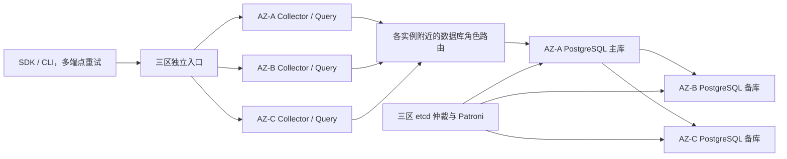

# 生产部署、高可用与运行方案

状态：生产运行要求与部署工件说明。仓库已有本地负载、真实 PostgreSQL 和 TLS 复制探针，生产部署与三区故障演练尚未完成；既有容量证据见 [REPAIR](implementation/REPAIR.md)，本次包含traces且不用Docker的范围与原生Linux验证见 [PRODUCTION-HA](implementation/PRODUCTION-HA.md)。用户明确目标为 99.99% 与单节点/单可用区故障下已确认数据不丢；其他数字为本方案的验证基线，需按业务负载校准。

## 1. SLO、故障模型与容量基线

| 指标 | 基线与范围 |
| --- | --- |
| 采集与查询可用性 | 分别为 99.99%，滚动 30 天；有效且处于声明配额内的请求，在服务截止时间内完成符合契约的响应 |
| 等价时间预算 | 259.2 秒/30 天；同时观察请求成功率与最长连续故障，不把二者混为同一指标 |
| 持久性 | 保留期内已确认事件，单节点或单可用区永久丢失下 RPO=0；其余故障域、存储和网络正常 |
| 故障恢复 | 单节点或单可用区故障后 30 秒内恢复符合契约的处理，必须实测 |
| 延迟 | 正常验证负载下采集 p99≤1 秒，有界查询 p99≤2 秒；从平台入口计量 |
| 数据与负载 | 100 万事件/天；峰值 500 事件/秒持续 10 分钟；95% 普通事件/5% 错误；整体平均 1 KiB |
| 查询负载 | 10 请求/秒，主要查询最近 24 小时，100 条/页，最大允许查询范围 7 天 |
| 保留 | 事件与错误 30 天，审计元数据 90 天，过期收据额外 7 天 |

上述容量与延迟没有实测证据。生产规模明显不同时，调整容量模型、查询索引、配额和资源，再跑相同故障负载，不能沿用未验证容量结论。

采集 SLI 分母包含因自身过载、错误切换、依赖故障造成的失败；超配额、未授权和非法输入按预先公开规则单列。SDK 未发送、浏览器离线与 Beacon 未确认另行计量。外部探针从平台网络外验证真实采集及查询，DNS/TLS/入口故障不能因请求未到应用而被忽略。

数据库同步复制保证依赖实际配置及故障域。整区域同时丢失、多个独立可用区同时损毁、逻辑误删和凭证失陷不被混入单可用区 RPO=0 承诺，分别通过备份与安全恢复方案处理。

## 2. 三可用区生产拓扑

每区至少一个 Collector 和一个 Query 实例；三台 PostgreSQL 数据节点和三台 etcd 仲裁节点分别按区分布。数据库与仲裁生产角色优先使用独立主机或有隔离保障的资源，不能把同宿主多个容器算成独立故障域。每个数据库节点都按可能承接主库的规格配置。

应用首期可使用 Linux VM/容器加 systemd 托管，不为了这个项目新建 Kubernetes。如果已有可靠的 Kubernetes，等价落实跨区反亲和、持久盘、预算和终止流程。数据复制、选主、磁盘与入口的高可用不能由自动重启替代。

公网使用各区独立 HTTPS 入口；生产 SDK/CLI 配置多个明确允许的端点，失败时在总预算内轮换。已有具备跨区切换能力的负载均衡可以提供统一域名。没有该能力时，不能只依赖低 TTL DNS 就保证 30 秒恢复；多地址失败、DNS 缓存和 TLS 行为必须实测。

同源浏览器代理依赖业务站点入口。业务站点本身不可用时，该代理不能提供独立采集通道；需要独立通道时配置平台的多区公开端点与明确 CORS 白名单。端点来自受控初始化配置，不由错误或事件里的任意 URL 指定。

数据库角色路由采用冗余或每应用主机就近的 HAProxy，检查 Patroni 的有效主库角色，不只做 TCP 存活检查。应用连接池只持有有限连接，故障后销毁旧连接并抖动重连。不要再给全部路由器套一个单实例 VIP 服务。

## 3. PostgreSQL、仲裁与旧主隔离

首期采用一个主库、两个跨区备库，至少一个异区备库同步持久化确认。Patroni 管理同步副本选择，不手工覆盖其生成的 synchronous_standby_names。

配置基线为 `synchronous_mode=true`、`synchronous_mode_strict=true`、`synchronous_node_count=1`、`synchronous_commit=on`、`fsync=on`、`full_page_writes=on`、`check_timeline=true`。严格同步副本不足时停止安全确认；不自动降级到异步。

仲裁采用三区各一个 etcd 成员。Patroni DCS 访问启用认证和 TLS，数据库复制链路启用 TLS 与独立最小权限帐号。etcd 的多数派、PostgreSQL 数据副本和应用实例是三个不同角色，不能相互代替。

旧主隔离要求 Linux watchdog required 模式或经过故障注入验证的等效 fencing。没有可靠隔离条件的节点不得成为可对外确认的主库。Patroni 的 watchdog 可在常规停止进程失效时增加隔离保障。[Patroni watchdog](https://patroni.readthedocs.io/en/latest/watchdog.html)

候选探针参数是ttl=30秒、loop_wait=5秒、retry_timeout=5秒，显式primary_start_timeout=0，避免PostgreSQL崩溃后等待默认300秒才尝试切换。watchdog采用safety_margin=-1，使设备超时为ttl的一半，并在真实设备上验证DCS更新后进程暂停的隔离路径。这些是演练起点，实际RTO还包括仲裁、提升、备库追赶、入口摘除、连接池重建和客户端重试；未量测前不宣称能在30秒内恢复。现有集群必须通过Patroni动态配置应用primary_start_timeout，不能只替换bootstrap文件。[Patroni动态配置](https://patroni.readthedocs.io/en/latest/dynamic_configuration.html)

同步复制会增加延迟，并在缺少安全副本时限制写入；必须保护数据而不是强制提升落后副本。健康时持续监控两个备库的复制延迟，保证失去一个可用区后仍有可提升、可恢复同步写入的节点。[PostgreSQL 同步复制](https://www.postgresql.org/docs/18/warm-standby.html#SYNCHRONOUS-REPLICATION)、[Patroni 复制模式](https://patroni.readthedocs.io/en/latest/replication_modes.html)

所有成功 COMMIT、重复确认与查询审计屏障采用 [服务端设计](BACKEND.md#6-批量写入事务与提交确认) 的保护规则。Collector/Query 数据连接固定并核验 client_min_messages=warning，保证同步等待取消的 WARNING 可达；无法恢复或核验时停止该连接的 HA 操作。独立提交截止、消息被屏蔽、取消同步等待、只读重复确认、异步降级都是故障验收重点。

## 4. 配置与权限运行机制

配置文件为版本化的结构化文件，包含 schema_version、revision、created_at、not_before、expires_at、项目/环境/服务注册、事件属性策略、Origin 白名单、公开写入 key、服务帐号摘要、配额、保留与受控端点。秘密单独注入，连接串、游标签名密钥、凭证和备份密钥不得写进仓库或普通日志。

配置在启动时完整校验，变更通过受控发布通道分发到所有实例；校验后原子替换。实例报告 active_revision、摘要和有效期。部署系统至少分布在两个故障域，不能成为所有实例重启时的单点；实例可使用本地有效的完整配置启动，不要求控制端每次在线。

建议每 15 秒检查一次可用配置更新，撤销或策略更新 60 秒内覆盖全部健康实例。配置有效期候选 24 小时，在剩余 1 小时前告警并更新。配置到期后停止新请求，不能无限使用旧权限；同时，分发故障不会立即使尚有有效配置的实例退出。该可用性与撤销时间取舍需要演练并纳入 SLO。

凭证正常轮换使用重叠窗口：先分发新 key → 客户端迁移 → 验证旧 key 使用归零 → 撤销旧 key。紧急撤销可提前收紧有效配置，但失联实例在收到更新或配置到期前的窗口必须明确记录。需要比该窗口更严格的即时撤销时，需要额外在线授权机制，不能声称静态配置已经提供。

游标签名使用专用轮换密钥，允许验证尚未过期的旧签名；仍须按当前凭证重新授权。项目配置变更通过部署系统审计；数据查询审计在 PostgreSQL 同连接事务中持久化。审计仅保存元数据，不能反向泄漏查询结果和用户明文。

生产配置启动要求指定 `profile=ha`、有效端点、可信代理列表、数据库 TLS 校验、保留策略及完整安全配置。开发 profile 可以使用本机地址与单机驱动，但不能在启动健康信息中标为生产 HA。

## 5. 超时、重试、连接与背压

| 层 | 建议预算 |
| --- | --- |
| SDK 每次尝试 | 5 秒，包含端点连接；整轮最多 5 次、总计 60 秒 |
| 边缘到应用 | 连接约 250 毫秒，应用响应截止约 4 秒；接收体积 32 KiB、头大小与慢请求有界 |
| 应用请求 | 总截止 3 秒；入站正文正常预算≤750 毫秒，所有子步骤使用同一个 deadline |
| 连接池等待 | ≤250 毫秒，超限拒绝，不无限排队 |
| 采集数据阶段 | 总预算约 500 毫秒，含锁与全部语句；单锁等待上限 200 毫秒 |
| 同步 COMMIT | 驱动按剩余请求预算扣除响应余量设置独立截止，候选上限 1 秒；到期先锁定未知再有界取消；statement_timeout 不提供同步提交等待上界 |
| 后端清理 | 独立保留连接，每轮清理截止候选 1 秒；未证实退出仍占预算，失败后告警并停止相应预算的新准入，不延长 HTTP 请求等待 |
| 查询 | SQL 预算约 1.5 秒，审计同步提交和序列化占剩余预算 |
| 优雅关闭 | 先摘流量，最多 15 秒排空；到期中断剩余请求，不能提前成功确认 |

预算是同一端到端 deadline 的切分，不能把每项独立延长后超过总截止。Fastify 的超时响应不会自动终止全部异步工作，必须继续取消普通 SQL、结束事务并清理连接；COMMIT 阶段按专门规则处理。[Fastify 超时行为](https://fastify.dev/docs/latest/Reference/Server/)

建议 Collector 每实例数据连接上限 10、Query 每实例 5，初始各 3 实例；每进程另外预留最多 2 条受控后端清理连接。预算按目标物理数据库节点统计，包含活跃、空闲及客户端已断开但后端退出尚未证实的会话。未知后端占用不因池对象销毁而归零；准入层在预算不足时停止建立新连接。

HTTP 截止与数据库后端退出分别计量；清理连接失联时不承诺后端按提交截止退出。进程重启或实例替换须盘点并接管带受控角色/实例世代/nonce 标识的遗留会话，完成物理节点预算对账后才恢复新准入，不能用空的新连接池重置预算。

扩展前计算最大副本数乘以每节点数据/清理连接上限，加维护、探针和管理保留。数据库 max_connections 的压测起点为 200，不是容量承诺。后端清理目标必须绑定原物理节点、PID、backend_start 和连接 nonce，不能向新主误发旧 PID 的终止请求。禁止多层独立无限重试，驱动只对明确已回滚的死锁/序列化错误再试一次。

内存限制同时按全实例、项目和事件类别约束。生产全局内存上限、并发 SQL、队列字节和最长排队时间写入配置。项目速率限制首期明确为每接收实例的令牌桶，响应披露配额作用域；平台总上界按最大实例数计算，不声称精确全局配额。需要精确全局配额时另设一致性设计，不能用分散内存计数充当全局计费规则。

配置内项目配额超限返回 quota_exceeded；平台资源不足返回 overloaded。SDK 不通过切换端点规避 429；遇明确节点连接故障可立即换区，仍遵守总次数和截止时间。有限缓冲只能吸收短暂故障，持续过载必须明确背压。

## 6. 容量模型与资源起点

100 万条/天、平均 1 KiB 的原始逻辑载荷约为 0.954 GiB/天，30 天约为 28.6 GiB。完整容量还包括信封、收据、元组、索引、WAL、审计、复制、备份和空闲余量。

计算方式：原始逻辑量 × 实测存储放大 × 保留期 × 副本数，加 WAL、备份及运维余量。压缩率与放大率必须从真实样本测量，不能用 JSON 字节直接当磁盘需求。

用于搭建压测环境的起点，而非生产规格承诺：Collector/Query 每实例 2 vCPU、2 GiB；每 PostgreSQL 节点 4 vCPU、16 GiB、500 GiB SSD；每 etcd 节点 2 vCPU、2 GiB、独立低延迟持久盘。入口、监控、备份和网络资源另计。数据节点规格必须以峰值写入、查询和 N-1 故障负载验证。

测试记录事件分布、单事件字节、SQL/连接池等待、WAL 速率、fsync、复制延迟、索引大小、GC、磁盘余量及端到端 p50/p95/p99。容量不足时先定位瓶颈，再选择索引调整、分片或分析存储，不能默认增加缓存或更换数据库就会解决。

## 7. 备份、恢复与发布

单可用区高可用与灾难恢复分别验收。灾备候选目标为区域级 RPO≤5 分钟、RTO≤4 小时，尚未得到业务确认。采用受支持的 PostgreSQL 备份工具、持续 WAL 归档、加密备份和异故障域保存；工具与目标存储在实施时验证许可证、版本和还原能力，不要求购买服务。

建议每日增量、每周完整备份，至少保留两条可恢复链；监控归档最新时间与失败。etcd 和有效项目配置分别备份，数据库凭证与解密密钥通过独立秘密恢复渠道保留。每月至少在隔离环境还原一次，核对抽样事件 ID、摘要、收据与时间点，记录实际 RPO/RTO。

发布顺序：构建并锁定工件 → 演练和校验迁移 → 先做兼容性扩展迁移 → 逐区发布一个实例 → 外部探针和 SLO 检查 → 继续发布。数据库/仲裁成员维护同一时刻最多影响一个故障域，并在下一步前恢复安全冗余。破坏性字段删除在所有旧调用方退出后单独执行。

迁移由独立工具/角色执行，使用数据库迁移锁；应用实例不在启动时并发 DDL。索引构建、分区维护和长锁超时单独验证。应用回退要求数据库模式仍兼容，不能把部署旧镜像当成数据回滚。

出现存储完整性问题、复制策略错误或旧主隔离失败时，优先停止确认、保全证据并恢复安全拓扑；不通过强制异步提交维持成功率。所有恢复动作记录目标、开始时间、确认数据集合和实际结果。

## 8. 平台自身观测

暴露独立 live、ready、metrics 端点。live 只判进程；Collector ready 要求有效配置、可借连接、兼容模式和安全写入能力；Query ready 要求查询及审计路径可用。不能因一次下游瞬时故障就无限重启健康进程。

核心指标包括入口成功率/延迟、按原因拒绝、确认未知、重复/冲突、池等待、队列丢弃、配置版本差异、同步副本、主库切换、仲裁与 fencing、磁盘与分区、WAL 归档和审计失败。指标标签禁止使用 user_id、request_id、event_id、错误全文等高基数字段。

结构化日志与独立 Prometheus/Alertmanager 等免费开源运维组件收集状态；通知依赖与外部探针跨故障域部署。平台自己的接收故障不能只靠向同一个 Collector 上报来发现。多窗口错误预算消耗、失去同步冗余、fencing 失效、备份不可恢复和容量临界必须有通知与处置负责人。

99.99% 的发布结论需要真实跨故障域证据。单机多容器、连接成功、健康检查通过或一次手工重启都不足以证明该目标。
