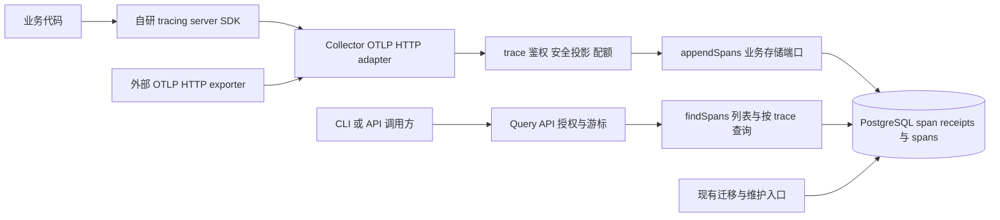

# 链路追踪技术架构设计

状态：首版实施架构，配套 [功能规格](TRACES-SPEC.md)、[设计审查记录](TRACES-REVIEW.md) 与 [实施验收](../implementation/TRACES.md)。生产部署及真实故障域验收单独执行。

## 1. 实现边界与依赖

protocol 拥有独立的 span/AnyValue/OTLP 模型，event/error 增加可选 span_id 关联；event 的 HTTP schema_version 仍为 1。tracing/server 是独立 Node 导出，不进入 browser/react/next-client 依赖图。

Collector 和 Query 仍是现有进程，trace 插件使用受限原始字节 parser、独立编码响应和共享请求生命周期。配置、storage contract 与数据库 schema 均为 2。PostgreSQL 复用既有连接、预算、同步提交和清理机制，增加 span 收据、trace_spans、trace_query_audit、RLS 和分区维护。CLI 只通过 Query API 检索，不连接数据库。

影响面包括公共导出、HTTP/DTO、持久化、配置、SDK 异步任务、CLI、构建和测试；无产品 UI/前端入口新增，现有 smoke 做开发/生产回归。真实四项门禁、独立夹具和部署边界见 [实施记录](../implementation/TRACES.md)。

## 2. 关键架构决策

| 决策        | 采用                                                                                         | 舍弃及原因                                                                                 | 重新评估条件                           |
| ----------- | -------------------------------------------------------------------------------------------- | ------------------------------------------------------------------------------------------ | -------------------------------------- |
| SDK 与 OTLP | 自研 span/context/sampling/export 生命周期和服务端 OTLP，零 OTel 运行时依赖                  | OTel SDK 不符合本次约束；只自定义 JSON 不足以互操作                                        | 用户改变依赖约束                       |
| Protobuf    | 固定官方 .proto，构建时生成 message codec，允许通用 Protobuf runtime；OTLP JSON 偏差自行适配 | 手写 varint/field tag/所有 wire 边界增加协议风险；通用 runtime 不提供 OTel SDK 能力        | codec 体积、运行时兼容或安全评估不合格 |
| 传输        | 同一 HTTP 路径支持 JSON/Protobuf 和 gzip                                                     | gRPC 新端口、HTTP2 栈无当前需求；只有 JSON 会限制通用 exporter                             | 有实际 gRPC 客户端需求                 |
| 进程拓扑    | 现有 Collector/Query 进程、统一 Postgres 驱动内新增 trace 能力                               | 额外 tracing 服务、Kafka、异步入库会增加确认与恢复边界                                     | span 负载经测试导致事件隔离不够        |
| 数据模型    | span 专表+span 收据，trace 按查询派生                                                        | 扩展 EventKind=span 会污染事件白名单和错误契约；trace 聚合表会引入乱序更新与完成状态歧义   | 经实测确有聚合查询需求                 |
| 部分成功    | 数据永久失败按 span 拒绝，余项同一事务确认；临时失败整批503                                  | 全批拒绝使一条坏数据吞掉其他 span；异步队列200无法兑现当前确认规则                         | 存储模型或外部契约改变                 |
| 精度        | 字符串/Binary输入无损转BigInt、PG numeric(20,0)；裸JSON数值遵循binary64语义                  | 不用Number处理精确字符串，也不用Date或微秒timestamptz存纳秒；PG bigint不能覆盖uint64全范围 | 明确的新协议范围                       |

“自行实现OTLP”在此指本项目拥有协议适配、验证、鉴权、导出、确认和查询；通用codec不引入OpenTelemetry SDK/API/exporter。使用`@bufbuild/protobuf`配套生成器作为新增通用codec方案；实施协议切片固定生成器、runtime版本与lockfile，并通过Node26/ESM/BigInt探针，不以未核实版本直接安装。JSON采用有界token parser以执行重复键和深度/节点限制；精确整数的字符串分支直接解析为BigInt，裸数值分支按ProtoJSON先binary64后转BigInt，两者不能混淆。不需要为裸数值额外发明无损协议偏差。

协议定义固定到 opentelemetry-proto commit `40cb2e516c60dd91796d909c7277e36a20c38b55`。只纳入 trace_service/trace/common/resource 及必要 google.rpc.Status/Any 定义，记录来源、SHA256 和许可证；生成物不暴露为业务公共模型。升级固定版本是显式协议变更，先比字段和 golden fixtures。googleapis Status 的来源也要在协议切片固定 commit 和校验和，不依赖 master 现场下载。生成物按上游许可证保留要求处理，不为了本仓库风格删除许可证。

## 3. 模块与数据所有权



| 模块                              | 拥有的规则/状态                                                   | 边界                                                                       |
| --------------------------------- | ----------------------------------------------------------------- | -------------------------------------------------------------------------- |
| packages/protocol 的 trace 文件   | OTLP message 适配、类型化 AnyValue、规范化、字段范围；无用户状态  | 无 Node/数据库/应用依赖；生成 codec 为私有细节                             |
| packages/sdk 的 tracing/server 图 | 本地 span 生命周期、每 tracer ALS、采样、冻结批次、有界重试与关闭 | Node-only；不被 browser/react/next-client 引用；不依赖 application/storage |
| application trace ingest          | 项目身份、资源服务授权、项目 trace_policy、配额与请求策略快照     | 不导入 PostgreSQL；不把 HTTP DTO 传入驱动                                  |
| application trace query           | read:traces、过滤器与签名游标、OTLP 与原 API 响应分流             | 无跨表隐式扩大权限                                                         |
| storage-contract                  | CanonicalSpans/TraceQueryAccess/SpanQuery/结果语义                | 与 HTTP/Fastify、具体 SQL 无关                                             |
| storage-postgres                  | receipt 唯一性、span 安全记录、并发、确认屏障、查询审计、保留     | 唯一权威持久状态；无 SDK 依赖                                              |
| CLI                               | 只经 query API 查询及流式输出                                     | 无数据库访问；资源预算和取消明确                                           |

按职责在既有 package 内增加文件，不新建独立服务或一串只做转发的 package。trace ingest/query/parser 从 index.ts 分离，但共享 runtime 的修改限于路由配置、编码响应和可复用生命周期，避免通用采集管线重构。

业务端口位于 TelemetryStore.traces，和 event writer/reader 共用一个 store 生命周期：

```ts
interface TraceStore {
  appendSpans(
    batch: CanonicalSpans,
    options: OperationOptions,
  ): Promise<{
    rejectedSpans: number;
    duplicateSpans?: number;
    conflictSpans?: number;
  }>;
  findSpans(
    query: SpanQuery,
    access: TraceQueryAccess,
    options: OperationOptions,
  ): Promise<SpanPage>;
}
```

CanonicalSpans 包含可信 projectId/environment/allowedServices、policyVersion、retentionDays/receiptDays 和规范候选 service/payload/digest；payload 为安全投影。应用按最终紧凑 JSON UTF-8 在 SQL 前拒绝超预算候选，driver 在 BEGIN 前复核硬上限，长度派生列由 driver 生成，不接收 HTTP 自述长度。驱动返回存储判断的永久拒绝和重复/冲突次数，不提供逐项外部 ACK；临时故障抛 StoreError。

列表与按 trace ID 查询使用同一 findSpans，详情的 trace_id/completeness 和空结论 404 由应用在审计成功后构造，不增加纯转发端口。TraceQueryAccess 单独声明项目、环境、服务集合、actor/request/query digest、审计期与 queryKind=spans|trace，不接收 event allowedKinds。驱动只在事务内部设置 trace RLS 的固定 signal 标识；trace 审计使用独立表。storage contractVersion 为 2，EventKind 仍仅 event/error。

## 4. 接收与协议实现

请求阶段顺序：

1. onRequest 取得一次有效配置快照；建立全局与 trace 子并发槽、body/总截止和 AbortSignal。拒绝 trace 路径的 Cookie/Origin、校验媒体/编码、凭证及 write:traces/环境权限；在读取/解压正文前完成。
2. trace 路由 preParsing Transform 按请求配置限制原始字节流，content parser 只做有界 Buffer 读取；gzip 使用 zlib 的 maxOutputLength 限制输出。压缩与输出分别计量，解压任务纳入 operation.pending，断连或截止不能提前回收仍在运行的任务槽。流在 end/close/aborted 时解除监听和管道；错误关闭连接，避免留下未读取正文。
3. 有界JSON tokenizer或生成Binary decoder转入中立trace DTO。限制解析深度、节点、resource/scope/span数；未知字段也受解析预算保护。JSON字符串整数无损解析，裸数值遵循binary64并在转BigInt后校验范围，禁止使用Number.toString作为大整数规范值。Binary对无效varint、截断、溢出和不合法wire type fail closed；未知字段可跳过，不进入业务摘要。Resource.entityRefs及profiling index扩展按规格显式忽略，不属于摘要支持字段。
4. 先扫描全部资源执行环境一致性/服务授权。任一越权整请求403，尚未写库；可定位的结构/语义失败累计 span 索引。配额按全部输入 span 出现次数预扣，任何失败不回补以防滥用；空批次不扣 span tokens。
5. 校验字段，形成与安全策略无关的规范摘要；根据当前配置生成安全投影。Resource/Scope 数据继承到每条候选，确保改变分组顺序不改变单 span 含义。
6. 一次 appendSpans，绝不把各资源拆成多个独立提交。确认后映射 ExportTraceServiceResponse；失败映射 Status。所有回应入口（parser/error handler/onRequest 超时/overload）都按 trace 路由选择编码器。

Fastify 默认 JSON parser 必须在封装的 trace plugin 范围内替换；event 路径仍保留32 KiB JSON与现有错误体。路由 bodyLimit 不能简单设成解压后限制：需要原始流上的压缩大小检查和解压输出检查，框架 parser 不得先无界缓冲。共享 runtime 当前直接 sendError 的 deadline 路径也需按 route response policy 分派，否则正常 handler 兼容而超时不兼容。

规范化规则由 protocol 单一实现：ID 小写、整数标准十进制、隐式默认值与显式默认值相同、null 归未设置、属性/kvlist 依 key 排序、重复业务 key 拒绝、事件与 link 数组保留原顺序。resource/scope/schemaUrl、service、原 name/status/traceState、所有已知 dropped counts/flags 都属于单 span 摘要。摘要包含固定 canonicalization_version=1，未知字段和接收元数据不包含。对 canonical bytes 做 SHA256，长度分隔且键稳定；不得使用原始 JSON.stringify 或原始 Protobuf bytes 作为等价判断。

同一已知语义的 JSON/Binary、属性顺序变化及 regroup 必须同摘要；浮点按 IEEE754 值规范化（-0 与 +0 等价，所有 NaN 等价），bytes 按解码字节规范化。摘要先于安全投影且不包含策略版本，因此热更新不会把合法重试变成冲突；重放时保持首次存储的投影，不写当前新投影。

## 5. 持久化、并发与确认

### 5.1 新表与访问路径

以下为数据库逻辑约束，实际 DDL 位于 storage-postgres/src/trace-schema.ts。

| 表                          | 必要字段、约束与所有权                                                                                                                                                                                                                                                                                                                                                                      |
| --------------------------- | ------------------------------------------------------------------------------------------------------------------------------------------------------------------------------------------------------------------------------------------------------------------------------------------------------------------------------------------------------------------------------------------- |
| telemetry.span_receipts     | PK(project_id,environment,trace_id,span_id)；service；payload_digest/canonicalization_version；first_received_at/retain_until/tombstone_until；first_operation_id/confirmation_nonce/policy_version。ID 长度/非零、digest 格式与 retain<tombstone 为 DB CHECK；业务载荷不可更新，只允许 confirmation_nonce 更新                                                                             |
| telemetry.trace_spans       | 按 received_at UTC 日 RANGE 分区；PK(project_id,environment,received_at,trace_id,span_id)；service、parent_span_id、name、kind、flags、status_code/status_message、start_ns/end_ns/duration_ns、safe_payload jsonb、policy_version、retain_until；FK(project_id,environment,trace_id,span_id)→span_receipts；CHECK 纳秒范围与 duration=end-start、end≥start、ID/父自身规则、retain>received |
| telemetry.trace_query_audit | audit_id UUID PK；project_id/environment/actor_key_id/request_id/query_kind/query_digest/services_digest/as_of/row_count/created_at/retain_until；query_kind 仅 spans/trace；无正文、ID 列表和 SQL                                                                                                                                                                                          |

不修改 event query_audit 的 allowed_kinds 语义；trace 审计专表避免把 event 类别强行扩展为 signal。start_ns/end_ns/duration_ns 采用 numeric(20,0)，约束0≤值≤18446744073709551615；kind/status_code 用 signed integer，flags 用 bigint 并约束 uint32；其他 dropped counts 保存在类型化 safe_payload。收到的所有纳秒值从 pg numeric 返回字符串，禁止自定义解析器转 Number。

分区表 PK 含分区键，跨日逻辑唯一性由非分区 span_receipts 负责；不能仅给分区表建立 `(trace_id,span_id)` 唯一索引。[PostgreSQL 分区约束](https://www.postgresql.org/docs/18/ddl-partitioning.html#DDL-PARTITIONING-DECLARATIVE-LIMITATIONS)

必需索引：

- trace_spans `(project_id,environment,received_at DESC,trace_id DESC,span_id DESC)`：分页。
- `(project_id,environment,trace_id,received_at DESC,span_id DESC)`：有限范围 trace 详情。
- `(project_id,environment,service,received_at DESC,trace_id DESC,span_id DESC)`：服务过滤。
- span_receipts `(tombstone_until)` 与 trace_spans `(retain_until)`、trace_query_audit `(retain_until)`：有界维护。

name/status/duration 可先在限定项目/时间/分页预算内过滤，不首发 JSONB GIN 或每属性索引；在压测中若扫描量过大，再为真实组合加索引。跨 partition 查询仍必须带 received_at 范围。safe_payload 是权威安全记录；查询列是同事务生成的必要投影，不可独立异步更新。

trace_spans新增派生列safe_payload_bytes，integer NOT NULL，CHECK值在0–1 MiB内，保存上述安全投影的字节计量；与safe_payload及其他查询列同事务生成，重放不可修改。JSON字段的类型包装、转义和UTF-8均参与计量，不能采用PostgreSQL jsonb文本的空格格式或原始输入长度替代最终查询表示。可信接收元数据最多16 KiB，配置启用trace时校验项目/环境/服务及策略版本等可表达值；query编码器复核上界。源span的256 KiB、规范安全投影的1 MiB、查询页的4–8 MiB是不同预算，不能相互替代。

### 5.2 一次 appendSpans 事务

沿用 driver 的连接获取、data/commit/response 预算、最多一次已回滚 deadlock/serialization 重试、WARNING 监听、SyncRep 清理和跨节点残留处理；不复制一套提交实现。BEGIN 采用现有写事务的 READ COMMITTED。

1. 校验可信 scope、候选数/摘要/索引；先按身份分组，批内异载荷的该组全部拒绝，同载荷组只占一份存储但记全部 accepted 次数。
2. 设置 transaction-local RLS scope；相同项目环境内全部服务授权集合来自应用，而不是输入自由集合。按 `(project,environment,trace,span)` 全序申请/插入收据，ON CONFLICT DO NOTHING，避免交叉批次逆序锁。
3. 调用受限 DB 函数 confirm_span_receipts，按相同全序锁定本项目/环境全部候选收据并更新 confirmation_nonce，包括因服务 RLS 不可见的冲突收据；返回 touched_count，必须等于去重候选数，否则503回滚。之后用普通 RLS SELECT 读取可见收据，在同连接比较 payload_digest、service、保留期与必要版本。摘要/服务冲突、到期墓碑为永久拒绝。被触及但对当前服务集合不可见的收据归为固定 identity_conflict，不返回原服务信息。
4. 对本事务新建收据插入对应 trace_spans；预校验和批内异载荷拒绝已在 INSERT 前排除，故新收据必须全部有安全业务行。存储阶段只有已存在收据才会冲突或过期，不需要给 collector 增加 DELETE 权限。新收据遇到其他验证/SQL异常整事务回滚，禁止留下孤立收据；已存在收据不能删除或改写。
5. 检查每条 accepted 收据都有对应 first_received_at 的安全记录；缺行、分区不存在或任何临时 SQL 故障整事务失败。不能把完整性错误当永久 span 拒绝。
6. 再核验 synchronous_commit=on、client_min_messages=warning、主库状态及 ha 同步备库，预留响应预算后受控 COMMIT。包括全部重复确认在内，都必须产生新的 WAL 写屏障后才允许200。
7. 返回 accepted/rejected 次数；应用合并入库前永久拒绝与投影警告。accepted=0 且全为预校验拒绝的请求不需要写库；一旦访问收据进行冲突/到期判定则该结论也需受控事务屏障。

首次 received_at、retention 和策略版本取数据库事务时钟与当前请求策略快照，一次写入；重复更新仅为确认屏障。receiptDays 是 traceDays 到期后的额外天数。幂等窗口到 tombstone_until 结束，不承诺永久去重。

RLS：新表 ENABLE+FORCE ROW LEVEL SECURITY；collector 在可信 project/environment/services 下 SELECT/INSERT，不获得 receipt DELETE 或任意载荷 UPDATE；query 只 SELECT 已授权 span，不授予 span 写入；audit 只 INSERT 当前 scope；维护只走受限管理角色。

confirm_span_receipts 是唯一允许跨 service 触及隐藏收据的能力，只能更新 confirmation_nonce，不能返回收据正文。该函数 SECURITY DEFINER、归 telemetry_owner 所有、固定 search_path=pg_catalog/telemetry、撤销 PUBLIC EXECUTE，仅授 collector EXECUTE。输入为最多512个唯一 trace/span key 和新UUID nonce；project/environment 只取 transaction-local scope，必须非空；函数拒绝超限、重复或非法key。函数自行限定 project/environment，使用已有 owner 专属 RLS policy，不改变 collector 的服务过滤；按完整身份排序 FOR UPDATE 后更新，返回受影响行数，不返回 service/digest/时间或其他租户存在性。所有候选先通过 INSERT 的服务授权检查，函数不能创建新收据。外层事务核验设置与同步 COMMIT，因此隐藏冲突的永久结论同样有新 WAL 屏障。

首版512是统一协议硬上限，接收配置max_spans只能在1–512之间收紧；SDK、应用、driver校验及迁移函数定义从同一协议限制派生，不在各底层重复数字。调大硬上限需要显式协议/存储契约变更与验证，不能只改配置绕过确认函数。

本地隔离探针在 PostgreSQL 18.6 证实：跨服务隐藏唯一冲突的 INSERT DO NOTHING=0、普通SELECT=0、普通nonce UPDATE=0；受限函数可仅更新当前项目隐藏收据nonce，collector仍看不到正文，其他项目nonce不变。该探针验证 SQL/RLS 路径，不证明生产HA或并发压力结果；复现条件及输出见审查记录。不得删除服务RLS来实现确认。

### 5.3 失败窗口

| 窗口                                 | 结果与恢复责任                                                            |
| ------------------------------------ | ------------------------------------------------------------------------- |
| body 未完成、解码/授权失败           | 无 SQL；取消读取，释放槽位；永久错误不重试                                |
| 事务未提交时数据库故障               | rollback 或 discard；503，发送方保留相同批次                              |
| COMMIT 发出后连接断开/截止/同步取消  | outcome=unknown，仅内部指标与日志分类；OTLP 返回503；不得返回“已拒绝全部” |
| 本地已提交但没有同步确认             | 读到收据不足以成功；重试 nonce 写屏障，复用原首次记录                     |
| 已同步提交但 HTTP200 丢失            | 同身份重试，通过新屏障返回同语义，不延长保留                              |
| 库内一个 span 冲突、其余合法         | 冲突永久拒绝，其余同事务确认；200 partial                                 |
| 合法数据与永久坏数据混合，但入库失败 | 整请求503；不得发200 partial；重试会重新确定永久拒绝                      |
| 多 Collector 并发重放                | 唯一收据+全序锁；后到者比较摘要，必须等待并通过自身确认屏障               |

HTTP 超时后不能提前释放“仍在持有数据库连接”的全局槽。共享 runtime 现有 pending 计数继续覆盖查询取消与清理，只有响应结束且 operation settle 才释放；无无限后台写入、无 detached promise。

## 6. 查询、保留与配置

findSpans/readTracePage 在同连接 REPEATABLE READ READ WRITE 事务中读取、写 trace 审计、同步提交后返回，固定 as_of 判定到期；复用连接事务 helper，但按读取的 trace_spans 父表取得 ACCESS SHARE 锁，不能误锁 event 表。审计的异常、无结果或最终404都必须跨屏障后才输出，失败不返回已读内容。

received_at 是排序与时间范围依据；duration 按 span 本地时钟推导，展示不把 max(end)-min(start) 称为真实全链路耗时。分页为 live，迟到 span、过期数据及权限变更按规格处理。driver 返回结构化 next key，应用负责签名；不能拼接用户 SQL/order。

查询在同一审计事务内先读取满足全部筛选的窄投影（排序key、safe_payload_bytes，最多limit+1项），不先取500个完整JSON再丢弃超页部分。按序累计safe_payload_bytes+16 KiB/项，给页信封预留16 KiB，从中选取不超过limit且满足page_bytes的连续前缀；只对该前缀读取完整safe_payload。探测项仅用于判断是否还有下一页，cursor从最后返回项生成，audit row_count同样只计该前缀。

响应编码和字节计量使用一致的紧凑JSON表示。driver在审计COMMIT前复核所选安全投影的实际字节与派生列一致、可信接收元数据≤16 KiB/项，并按所选前缀写审计；不依赖HTTP编码器或游标签名实现。应用在屏障后签名和编码完整响应，签名游标最长8 KiB、全部信封≤16 KiB，最终响应体必须≤page_bytes。派生长度、元数据上界或最终编码不一致返回503 storage_unavailable，不发送部分JSON或跳过异常项。审计row_count记录本次查询准备输出的前缀数量，不是客户端收件证明；后续编码/网络失败不回写审计。每个有效新span均可放入最小合法页，通过保守计费实现有界读取，不承诺把预算用满。翻页时from/to取签名游标快照，page_bytes热更新使旧游标失效。

CLI保持现有8 MiB解压后响应保护，trace页预算配置只能在4–8 MiB内；NDJSON每页验证后写出并沿next_cursor继续，短页不视为完成。真实HTTP→CLI测试必须覆盖超8 MiB的整体trace跨多个合法小页导出，不能以mock page代替API页预算验证。新查询预算不影响现有event API。

保留维护扩展当前 `db:maintain`：为 spans 预建至少未来7天及昨天/今天分区；删除到期业务行；仅当旧分区不存在 retain_until>as_of 的行才删除分区；之后批量清理没有业务行引用且 tombstone_until≤as_of 的收据；审计按自身保留期删除。每阶段同样有 lock timeout、总 deadline、batchSize，维护返回新增 spansDeleted/spanReceiptsDeleted/traceAuditsDeleted 统计。不得因修改 retention.trace_days 就批量提前改写旧 retain_until。

readiness在启用traces的新版本上检查：schema version、今天span分区、3张trace表、RLS+FORCE、必要索引/权限；确认函数存在且owner/search_path/PUBLIC撤权/collector EXECUTE正确；普通collector仍受服务RLS约束且没有payload UPDATE/DELETE权限；query audit INSERT和同步确认能力。event原有检查不删除。缺任一条件停止接收trace；不能声称app ready但trace endpoint 200后丢数据。

配置位置与语义：

| 位置                                        | 内容                                                                                                                                                          |
| ------------------------------------------- | ------------------------------------------------------------------------------------------------------------------------------------------------------------- |
| `limits.traces`                             | 规格第7节的 body/response/数量/深度/key/value/单 span 大小预算，以及 max_concurrent 子配额                                                                    |
| `limits.trace_queries.page_bytes`           | 缺省4 MiB，范围4–8 MiB，包含完整未压缩JSON响应；独立于采集response_bytes                                                                                      |
| `retention.trace_days`                      | trace 保留天数，使用规格范围                                                                                                                                  |
| `projects[].service_accounts[].permissions` | 增加 write:traces/read:traces；任一 write:* 与任一 read:* 不得共存；未知权限拒绝                                                                              |
| `projects[].trace_policy`                   | 分层属性schema、名称/version/schemaURL白名单、safe_messages、tracestate_rules（vendor→safe_values/max_value_bytes）；空规则删除全部tracestate，不保存自由文本 |
| `projects[].trace_quota`                    | spans_per_second/burst；每实例、独立于事件配额，burst≥limits.traces.max_spans                                                                                 |

配置总 schema 升为2，以区分现有严格 schema 1；新代码只读2，部署通过离线转换给所有旧项目填安全默认 trace_policy/配额/限制，原事件配置逐项保留。没有 trace 权限的旧帐号仍不能 trace。服务端按配置 revision 快照处理在途请求，下一请求才用新策略；不创建在线 v1/v2 双读回退或旧环境字段别名。

协议 schema 的 `/v1/traces`、配置 schema 2、存储 contractVersion 2、数据库 schema version 2 是不同版本轴，不互相替代；event 的 HTTP schema_version='1' 保持当前行为。

## 7. SDK 运行机制与资源预算

SDK span 生命周期为 recording→ended→queued→in_flight→confirmed/partial/dropped；可重试失败进入 retry_wait，未采样为 nonrecording。end 冻结 span 内容，批次在首次发送时冻结 resource/scope/环境和字节编码；所有 endpoint 切换使用相同身份载荷，不生成新 ID。队列 byte/count 同时含在飞和退避项，避免仅移出队列就突破内存限制。

内部终止结果区分confirmed/rejected/unconfirmed/dropped，pending为仍在queued/in_flight/retry_wait的逻辑状态，按Spec6.1互斥结算。每个入队span分配本地单调序号，flush记录当时待处理集合和最大序号；完成后不保留无限历史ID，只保留活跃调用需要的有界批次计数及累计诊断。调用截止仅冻结该结果，不能清空共享队列或重置重试预算；close统一停止发送器，再按各原快照结算所有等待者。

打包器不得跨尚在等待的flush序号边界合批，保证无逐项身份的partialSuccess计数可完整归入每个观察快照；已有在飞批次整体纳入之后建立的快照。重叠flush共享发送和批次结算，不各自启动fetch；累计diagnostics只在一次逻辑终止时增加。重复close共享首次关闭操作和冻结结果，关闭后新flush为空；队列先前的采样/溢出等丢弃只在累计诊断中出现，不倒灌单次结果。

withSpan 在每实例 ALS.run 中执行；原异常原样传播，SDK 的记录/网络异常只进诊断，不使业务回调失败。startSpan 的非法配置属于初始化/调用错误，初始化可抛；业务运行阶段的超限属性或已关闭状态不抛出网络错误。没有全局 currentSpan、没有事件客户端隐式读取 tracing 的单例。

导出仅实现 OTLP JSON（客户端子集），接收端完整支持两种编码；JSON 编码在 typed DTO 上生成，BigInt 转字符串。transport 不复用现有强校验逐 event ACK 的实现，只复用已明确独立的 endpoint 校验/取消等公共能力；禁止通用化到牺牲 event ACK 规则。首版不上报 gzip，但接收端必须支持。

重试总预算从首次尝试前开始，包括每次网络、endpoint切换、Retry-After和backoff；maxAttempts含所有endpoint上的尝试。partial按有效响应的批次计数结算快照结果和累计诊断，不映射具体span ID；rejected>输入数量、负数或响应类型错误均为未知结果，不伪造confirmed。成功空Binary响应与JSON空对象按对应codec处理；只依据200而忽略畸形body不合格。

recording阶段同样受Spec第6节增量预算约束：先验证循环/深度/节点/长度，再有界复制；每个handle维护自身计费，tracer只持有active数与recordingBytes计数，不持有无限handle列表。初始links、resource/scope及持续addEvent/setAttribute均不能绕过限制；drop策略区分dropped_attributes/events/links与active_limit等本地原因。end转移recording到queued预算时原子释放前者，重复end/close不二次扣减。close后的在途handle不能继续保留新增payload，结束时释放已有自身引用。withSpan持有到回调settle，无自动延长业务的后台任务。

tracestate提取、parent/link接入、inject及Collector持久化均使用vendor→精确safe_values/长度规则，默认清空；不把vendor key白名单当成内容安全。Node [AsyncLocalStorage](https://nodejs.org/api/async_context.html#asynclocalstoragerunstore-callback-args)仅用于传播不可变context，不在store中累积整批payload。flush快照有边界，close清除所有export timer/abort listener/retry task并释放队列引用；进程硬退出前没有确认的数据不属于平台RPO保证。

## 8. 运行观测、容量与发布

新增有界指标：trace 接收/接受/拒绝/重复/冲突数量、按固定原因的永久拒绝/投影删除、压缩前后字节、解码时长、写入与提交时长、活动 trace 槽、503 unknown、维护积压；SDK diagnostics 区分 sampled_out/queue_full/too_large/permanent/partial/retry_exhausted/closing。HTTP 请求指标继续复用现有 route/status 体系。

标签限 route/status/固定 reason，项目标签仅允许有效配置项目 ID且配置删除时清理；禁止 trace_id/span_id/name/URL/token/用户属性成为 metric label。日志只含 request_id、配置 revision、固定原因与计数，秘密和原始正文不记录；需要排查特定 trace 时使用受审计查询。

沿用平台99.99%与已确认数据单故障域RPO=0目标，但当前 event 基线不能证明 trace 容量。trace 压测基线为候选：500 spans/s持续10分钟、10 reads/s、平均安全 span 2 KiB、每 trace 20 spans、10%带 event/link，分别测JSON/Protobuf/gzip；记录真实分布、CPU、RSS、GC、连接等待、表/索引大小、replication lag、端到端 p50/p95/p99和错误率。候选延迟沿用采集p99≤1s、查询p99≤2s；与现有 event 同时施压验证子并发配额与共享池不会破坏 event 基线。

用户确定生产交付同时覆盖event/error与traces，并要求不用Docker。目标部署采用原生Linux服务与systemd，数据库/Patroni、三区etcd、独立入口、备份和外部探针均须落实到真实故障域；现有Kubernetes应用工件不视为原生部署已经完成。当前仅获准访问的wr是单主机，10项同机TLS检查不能替代三区、旧主fencing、N-1和还原演练。当前事实、分阶段实施与生产门槛统一记录在[生产高可用交付与验收](../implementation/PRODUCTION-HA.md)。

30天×100万spans/天×2KiB约57.2GiB，仅为原始安全载荷算例，不含收据/索引/行开销、WAL、审计、复制与备份；部署资源必须以真实压测和保留样本确定，不能把该估算当容量结果。默认max_spans512和4MiB是保护上限，不等于该上限下仍满足p99目标。

发布是附加能力上线，不迁移历史 event 为 span：

1. 离线验证 schema1→schema2 配置转换，保存原配置；停止配置热更新，准备一次受控发布窗口（目标≤30分钟，实施演练后设定实际值），新SDK/权限尚不启用。采用新旧实例两组入口切换，不能把不兼容的配置原地滚动覆盖。
2. 数据库增量迁移1→2：在既有 advisory lock/事务下显式替换 schema_version 的 CHECK(version=1) 为窗口内 CHECK(version IN (1,2))，保留1记录、插入2记录；新增 trace 表、函数、RLS和索引，不重建或清空 event 表。旧 readiness 精确查1，新 readiness 精确查2，均须只返回一行；不能只 INSERT2 而忽略现有 CHECK，也不让新版本回退接受1。
3. 为避免长期双轨，新旧应用不能共享不同配置格式的同一路径：使用独立部署路径分别挂载旧1和新2配置，先启动新 Collector/Query 并通过 probes，再切入口流量；旧实例仅在发布窗口排空，不接收trace。
4. 入口稳定后停止旧实例与旧配置分发，删除临时部署路径，恢复仅schema2热更新。观测健康实例config revision/digest一致、event成功率、span真实写读探针、旧实例活动请求=0；达标即在同一发布收口删除schema_version=1记录并将CHECK收紧为version=2，删除兼容部署，不保留运行时代码的schema1解析或旧span字段。未完成此步骤不算切换完成。
5. 最后分发 write:traces/read:traces、发布新SDK入口和CLI；首次生产trace写入前完成故障回放/安全探针。

回退：发布窗口内可停止新实例、恢复原配置/旧应用，增量trace表可以保留；收口前保留的schema_version=1支持旧readiness。收口后若需事件应用回退，先由受控管理迁移临时放宽版本CHECK并重新插入1记录，再恢复旧事件入口；不运行旧migrate脚本、不删除2或任何业务表。该恢复也是有限回退窗口，前向修复后立即删除1记录并收紧CHECK。已有trace写入后不得回退删除表或恢复旧备份；暂停trace入口返回503、继续用新维护程序保存全部已确认span的保留管理，trace查询可由新Query实例继续提供；事件入口可独立回退，新SDK仍有有限重试预算。旧二进制不具备trace保留维护与查询能力，不能作为完整trace回滚目标。

兼容窗口仅为一次发布排空，退出条件是上述观测达标与旧实例清零；到窗口截止未达标则回退入口并取消开通trace，不能无限延长双配置。授权/配置原子性按实例保证，不宣称整个集群同时更新。

## 9. 实施切片与验证

| 切片              | 前置       | 实施范围                                                               | 完成条件                                                                                               |
| ----------------- | ---------- | ---------------------------------------------------------------------- | ------------------------------------------------------------------------------------------------------ |
| A 协议与关键探针  | 本方案定稿 | 固定 proto/codec/JSON parser；canonical/AnyValue；独立夹具             | JSON数字精度、两编码等价、gzip与限制、未知字段、Status golden；将RLS与受限确认函数探针转为并发集成用例 |
| B 存储            | A          | contract2、表/角色/RLS/版本迁移、appendSpans、查询审计与维护/readiness | 并发/冲突/墓碑/缺分区/同步屏障及旧事件路径真实PG回归                                                   |
| C Collector/Query | A+B        | trace鉴权/配置2/HTTP parser/响应分流/配额/游标/查询字节截页            | Spec T01–T10/T12/T13/T15/T17跨模块契约与故障路径通过                                                   |
| D SDK与CLI闭环    | C          | tracing/server入口、ALS/W3C/采样、导出/关闭、CLI/关联字段              | 两服务父子调用→入库→授权API/CLI输出；T16快照计数与T18发布产物验证；不引入OTel运行包                    |
| E 交付与发布验证  | A–D        | 公共文档、配置样例、部署/运维/探针、构建入口                           | 四项检查、覆盖率、现有双模式E2E、负载/HA证据、发布/回退演练                                            |

单测放各模块同目录`__test__/`，共享golden/协议fixture放`tests/support/trace/`，不跨模块导入私有测试。以下为用例设计依据；实际执行结果见实施记录。

### 9.1 独立协议夹具

Binary golden由固定官方.proto和独立protoc工具链生成，记录proto commit、生成器版本、输入文本及产物SHA256；独立工具的解码结果与人工确认字段表一起保存。生产生成器或生产decoder不得作为唯一oracle。

OTLP JSON golden采用固定提交的上游OTLP JSON示例，或按Spec3.2逐字段人工审核的原文向量；记录来源URL/commit、SHA256、审核后的字段值、预期接受/拒绝及原因。通用protoc默认ProtoJSON不是OTLP JSON oracle；不得调用生产JSON adapter、canonicalizer或serializer从Binary生成JSON期望。两编码均需与独立字段表比较，不能仅断言两者互相相等。

最小向量包括合法32/16位hex ID与数字枚举、错误base64 ID/枚举名称、lowerCamelCase/snake_case、未知字段、缺省/null、重复JSON key/oneof、AnyValue全类型、uint64/int64边界及异常wire bytes。重复键和oneof反例保留原始JSON文本，不能先构造对象再JSON.stringify，避免测试自己消掉故障输入。已知浮点/整数解释期望直接使用Spec3.2给出的数值，不复用被测转换函数。

摘要除两编码等价外，还要有有区分力的差异反例：属性重排/regroup/未知字段不变；改变已知原始敏感属性，即使安全投影相同，也必须冲突。人工duration算例为end-start=123456789ns；恒定返回值或两个codec共用的错误转换不能同时通过这些断言。

### 9.2 行为验证矩阵

| 场景                       | 独立预期与应失败的错误实现                                                                                                                       | 最小入口与替身边界                                                                                     |
| -------------------------- | ------------------------------------------------------------------------------------------------------------------------------------------------ | ------------------------------------------------------------------------------------------------------ |
| 协议互操作                 | 固定字段表、纳秒算例、等价及差异摘要；错误hex/base64、枚举或数值转换必须失败                                                                     | protocol公开入口；codec/规范化/摘要执行真实逻辑                                                        |
| HTTP前置拒绝与取消         | 授权资源+未授权资源整请求403且零写入；半包/gzip边界取消并释放槽；未结束store operation仍占槽；所有错误入口使用对应Status编码                     | HTTP映射可替身store；真实socket验证流/超限/断连，finally关闭socket/app并解除阻塞                       |
| 部分成功/隐藏冲突/未知确认 | A、A、坏B、同身份异载荷C/C′拒绝3次、只存1条A；临时故障503；全为RLS隐藏冲突也需新同步屏障；反向key序并发不重复/不泄漏                             | 真实PG writer+HTTP；暂停复制/触发SyncRep WARNING并检查清理连接归零，不用内存fake证明锁或HA             |
| 安全策略与保留             | 敏感标记不出现在各层安全数据、日志、响应或指标；在途revision固定；重复不改首次投影/保留；旧start time不提前过期、墓碑不复活                      | 真实投影+HTTP/PG；只替身日志出口和故障点，控制数据库时间状态并验证读/维护并发                          |
| SDK记录/上下文             | 两请求/两tracer不串链，原异常对象重抛；采样阈值两侧和等号、父sampled继承、W3C向量；recording预算阻止无限追加                                     | SDK公开入口和真实ALS；仅控制时钟/随机/网络，后续span可记录以证明配额释放，不锁定私有字段               |
| SDK快照/关闭               | Spec6.1数值算例、两个重叠flush、禁止跨快照合批；partial不重试；close后无fetch/timer，旧结果冻结                                                  | 受控fetch/流/fake timers，恢复全部替身；真实Node子进程验证自然退出，不用增加sleep换绿                  |
| 查询/CLI大页               | 相同received_at按ID分页无漏重；改权限/过滤/page_bytes游标失效；审计失败不输出已读内容；64个大span跨页全部导出，短页仍继续，取消/后页失败非零退出 | 真实PG→HTTP→CLI，独立核对输出身份/数量；临时目录、文件、app/store均清理，mock page仅覆盖客户端错误分类 |
| 配置/产物/回退             | schema1转换保留事件规则且不扩大帐号权限，1/2窗口最后仅2；已有trace回退不删数据；发布包tracing/server可导入，browser图不含Node/OTel运行包         | 配置公开接口、真实PG和构建产物；不以源码exports或放宽架构正则代替验证，保留双模式E2E                   |

不照搬现有event的逐项ACK、冲突整批回滚、flush包含后加入事件或详情410行为作为trace预期。先完成三项新增契约及独立向量，再按协议→真实PG身份/确认→HTTP→SDK/查询/CLI→发布产物的顺序取得证据；测试失败需定位行为，不弱化断言或门禁。

真实数据库需验证唯一性、RLS隐藏冲突、全序锁、墓碑窗口、分区清理、读审计屏障和numeric全范围；内存fake不足以证明。HA沿用tests/system/synchronous-confirmation与TLS三节点测试，新增重复确认、查询审计、SIGTERM/超时/WARNING/主备切换及清理无残留连接，不能仅依据COMMIT返回文本。

实施时先跑相关入口：`bun run test:unit <对应测试文件>`、`bun run test:integration <对应测试文件>`；新增system测试文件后经现有integration入口运行。现有浏览器回归按影响选择`bun run test:e2e e2e/telemetry.spec.ts`。里程碑运行真实四项：`bun run lint`、`bun run typecheck`、`bun run build`、`bun run test`。报告实际用例数和四项覆盖率，不把候选测试计划说成已通过。

尚需实施证据、但不阻止方案交接的条件：通用codec/runtime精确版本与构建体积、有界JSON token parser的资源验证、隐藏冲突确认函数的并发/HA集成、真实trace分布/压测资源、跨故障域持久性与发布回退演练。任一探针推翻本设计，应先同步修订规格/架构及审查，再实现相关行为。
